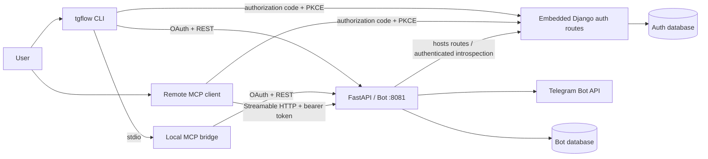

# TG Flow MCP and CLI

TG Flow exposes the authenticated user's Telegram mentions and explicitly enabled full-chat feeds through a remote MCP server. A local command-line interface and stdio bridge provide the mention workflow. The implementation targets MCP protocol revision `2026-07-28` and uses OAuth authorization-code flow with PKCE `S256` for public clients.

## Architecture

The diagram shows the default local ASGI mode:



The remote MCP endpoint is a resource server. It never accepts a user ID from a tool caller: every database query derives the user from the validated token subject. The local stdio server does not run an OAuth flow over stdio; it uses the CLI's locally stored OAuth session to call the same protected REST API.

By default, `tg_flow_bot` routes Django authentication and OAuth requests through its FastAPI application on port 8081; a separate port 8000 auth listener is not required. Internal auth requests use local ASGI in this mode. The auth database is configured explicitly and may be separate from the bot database.

## MCP endpoint and capabilities

- Streamable HTTP endpoint: `POST /mcp`
- Protected Resource Metadata: `GET /.well-known/oauth-protected-resource/mcp`
- Transport mode: stateless, JSON responses
- Mention tools: `list_mentions`, `get_mention_stats`, `get_mention_context`, `archive_mention`, `reply_to_mention`
- Chat capture tools: `list_chat_subscriptions`, `list_chat_messages`
- Resource: `tgflow://mentions/{mention_id}`
- Prompt: `triage_mentions`

Read operations require `mentions:read`. Archive, restore, and reply operations additionally require `mentions:write`. Write tools have MCP annotations and return an OAuth `insufficient_scope` challenge when a client needs incremental authorization. Clients should still obtain explicit user confirmation before sending a Telegram reply or changing archive state.

`list_chat_subscriptions` returns only subscriptions owned by the token subject. `list_chat_messages` succeeds only while that subscription is in `full` mode and returns messages saved after the mode was enabled. It accepts `limit` from 1 to 200 and an optional exclusive `before_message_id` cursor. Switching back to `mentions` immediately closes full-feed access. Message records preserve text or media captions; TG Flow does not download or expose attachment binaries through this tool.

## OAuth endpoints

In local ASGI mode, the embedded Django authorization server exposes:

- `GET /.well-known/oauth-authorization-server`
- `GET /oauth/authorize`
- `POST /oauth/authorize/decision`
- `POST /oauth/session/telegram`
- `POST /oauth/register`
- `POST /oauth/token`
- `POST /oauth/revoke`
- `POST /oauth/introspect` (resource-server credentials required)

The authorization flow uses exact registered redirect URI matching, PKCE `S256`, state, authorization-response issuer identification, explicit consent, and the OAuth `resource` parameter. Authorization codes are hashed, expire after five minutes by default, and are single-use. Access tokens are hashed and short-lived. Refresh tokens rotate on every use; replay revokes the entire token family.

Dynamic client registration is enabled for public authorization-code clients. Redirects must use HTTPS, except loopback HTTP redirects for native clients. Client ID Metadata Documents are intentionally not advertised because fetching arbitrary metadata URLs would add an SSRF trust boundary.

## Required configuration

The following values must agree between the Django auth and bot/MCP configuration:

| Setting | Django auth | Bot/MCP | Rule |
|---|---:|---:|---|
| `OAUTH_ISSUER` | yes | yes | Canonical public auth URL; TG Flow normalizes it with a trailing slash |
| `MCP_RESOURCE_URI` | yes | yes | Exact public MCP URL, such as `https://api.example.com/mcp` |
| `MCP_INTROSPECTION_CLIENT_ID` | yes | yes | Same resource-server client ID |
| `MCP_INTROSPECTION_CLIENT_SECRET` | yes | yes | Same strong secret; never expose it to an MCP client |
| Telegram token | `TELEGRAM_BOT_TOKEN` | `BOT_TOKEN` | Same BotFather token, used to verify Telegram signatures and call Telegram |

Production additionally requires HTTPS, a strong Django `DJANGO_SECRET_KEY` (or `SECRET_KEY`), exact proxy host/origin allowlists, secure cookies, and trusted CSRF/CORS origins. Terminate TLS at a trusted reverse proxy and ensure it overwrites, rather than appends, forwarded scheme and host headers. Do not log authorization headers, access tokens, refresh tokens, authorization codes, bot tokens, or URLs containing them.

Preserve the existing canonical public `OAUTH_ISSUER`, including its host and path, during cutover. In local mode, configure the reverse proxy so existing auth URLs and legacy proxy routes continue to reach the embedded Django routes on port 8081; an internal port change must not silently change discovery metadata or public OAuth endpoints. Django's allowed hosts must include the issuer host, including for local internal requests.

Internal auth calls default to `AUTH_LOCAL_ASGI=True`. For remote mode, set `AUTH_LOCAL_ASGI=False` and explicitly configure both `AUTH_API_URL` and `OAUTH_INTROSPECTION_URL`. Remote mode does not start local Django, serve its routes, or check its migrations: route public auth, OAuth, and discovery requests to the external auth service through the proxy. If either legacy URL is configured, set `AUTH_LOCAL_ASGI` explicitly to select the intended mode. Introspection retains resource-server authentication.

Preserve the existing auth database and its migration history, users, OAuth clients, grants, and token records, along with the existing Django `SECRET_KEY`, JWT signing keys, and other authentication secrets. Back up and verify these before any migration; replacing them can invalidate sessions, tokens, or client state. Production migration and compatibility have not been verified here.

Apply ingress rate limits to dynamic registration, authorization, token, and Telegram-session endpoints. The application registration limiter is defense in depth and is process-local unless Django is configured with a shared cache.

In local ASGI mode, set `AUTH_DB_ENGINE` and the applicable `AUTH_DB_*` values to the existing auth database. Check its migration history and back it up before applying any pending Django migrations. Local-mode startup checks database connectivity and migration state but does not apply migrations automatically. For the Docker deployment, run these from `tg_flow_bot` before starting the service, substituting the appropriate environment file:

```bash
cd tg_flow_bot
ENV_FILE=envs/dev/env.op make auth-migration-status
ENV_FILE=envs/dev/env.op make auth-migrate
```

These targets run a temporary container and require a built bot image, the specified environment file, an existing configured Docker network, and a reachable auth database. An SQLite database must be accessible and persisted at its configured container path. The bot's Aerich migrations use the separate `make migrate` command. Remote mode leaves auth migrations to the external service.

## Install and use the CLI

From the repository root:

```bash
python -m venv .venv-cli
.venv-cli/bin/pip install -e ./tg_flow_bot
.venv-cli/bin/tgflow auth login \
  --mcp-url https://api.example.com/mcp \
  --api-url https://api.example.com
```

The login command discovers the authorization server from the MCP resource metadata, registers a public native client, opens the browser, verifies `state` and `iss`, and exchanges the code with PKCE. Discovery refuses redirects, userinfo, fragments, unsafe schemes, and private/reserved destinations other than explicit local-development loopback URLs.

Common commands:

```bash
tgflow auth status
tgflow mentions list --limit 20
tgflow mentions stats
tgflow mentions context 42 --before 5 --after 5
tgflow mentions archive 42
tgflow mentions restore 42
tgflow mentions reply 42 "Thanks — I will follow up."
tgflow auth logout
```

Credentials are stored at `$XDG_CONFIG_HOME/tgflow/credentials.json`, or `~/.config/tgflow/credentials.json` when `XDG_CONFIG_HOME` is unset. The directory is mode `0700`, the file is mode `0600`, writes are atomic, and status output never prints a token.

For a desktop MCP host that uses stdio, first run `tgflow auth login`, then configure:

```json
{
  "mcpServers": {
    "tg-flow": {
      "command": "tgflow",
      "args": ["mcp", "serve"]
    }
  }
}
```

For an MCP client with remote OAuth support, configure the canonical URL `https://api.example.com/mcp`; the client should discover authorization through Protected Resource Metadata.

## Local development

Configure the auth database and use the integrated loopback defaults in `tg_flow_bot/envs/dev/env.op.example`, then run FastAPI on port 8081. The CLI accepts loopback HTTP only for development:

```bash
tgflow auth login \
  --mcp-url http://localhost:8081/mcp \
  --api-url http://localhost:8081
```

Run verification with:

```bash
cd tg_flow_bot && pytest -q && python manage.py check && ruff check .
cd ../tg_flow_frontend && npm test && npm run lint && npm run build
```

## Security invariants

- Remote MCP accepts OAuth access tokens only through the `Authorization: Bearer` header.
- Tokens are audience-bound to the exact MCP resource and are never forwarded to Telegram or another upstream service.
- Introspection requires separate resource-server credentials.
- MCP POST requests require JSON and validate `Host` and `Origin` before authentication to mitigate DNS rebinding.
- Telegram Login Widget and Mini App payloads are signature-checked and freshness-limited before creating a user.
- Chat photos are proxied; the Telegram bot token is never placed in a browser-visible redirect URL.
- Full-chat feeds require an owned subscription in `full` mode and never expose messages retained before that mode was enabled.
- Production disables registration and login by bare Telegram user ID.
- OAuth consent, Telegram session creation, and authorization decisions are CSRF-protected and framed pages are denied.
- CLI OAuth discovery does not follow redirects and rejects unsafe network destinations.

The implementation follows the MCP 2026-07-28 guidance for [authorization](https://modelcontextprotocol.io/docs/2026-07-28/tutorials/security/authorization), [security best practices](https://modelcontextprotocol.io/docs/2026-07-28/tutorials/security/security_best_practices), [architecture](https://modelcontextprotocol.io/docs/2026-07-28/learn/architecture), and [server concepts](https://modelcontextprotocol.io/docs/2026-07-28/learn/server-concepts).
