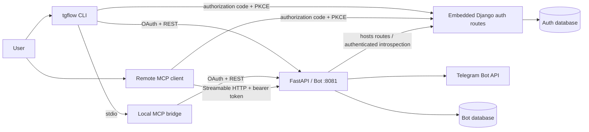

# TG Flow MCP and CLI

TG Flow exposes the authenticated user's Telegram mentions and enabled full-chat feeds through a remote MCP server. A local command-line interface and stdio bridge provide the mention workflow. The implementation targets MCP protocol revision `2026-07-28` and uses OAuth authorization-code flow with PKCE `S256` for public clients.

## Architecture

The diagram shows the default local ASGI mode:



The remote MCP endpoint is a resource server. It never accepts a user ID from a tool caller: every database query derives the user from the validated token subject. The local stdio server does not run an OAuth flow over stdio; it uses the CLI's locally stored OAuth session to call the same protected REST API.

By default, `tg_flow_bot` routes Django authentication and OAuth requests through its FastAPI application on port 8081; a separate port 8000 auth listener is not required. Internal auth requests use local ASGI in this mode. The auth database is configured explicitly and may be separate from the bot database.

## MCP endpoint and capabilities

- Streamable HTTP endpoint: `POST /mcp`
- Protected Resource Metadata: `GET /.well-known/oauth-protected-resource/mcp`
- Transport mode: stateless, JSON responses
- Mention tools: `list_mentions`, `get_mention_stats`, `get_mention_context`, `archive_mention`, `reply_to_mention`
- Chat capture tools: `list_chat_subscriptions`, `list_chat_messages`, `list_unread_chat_messages`, `mark_chat_read`
- Business private reply tools: `reply_to_chat_message`, `get_chat_reply_status` (deployed 3 November 2026; live outgoing verification pending)
- Resource: `tgflow://mentions/{mention_id}`
- Prompt: `triage_mentions`

Read operations require `mentions:read`. Archive, restore, reply, and mark-read operations additionally require `mentions:write`. Write tools have MCP annotations and return an OAuth `insufficient_scope` challenge when a client needs incremental authorization. Clients should still obtain explicit user confirmation before sending a Telegram reply or changing archive state.

`list_chat_subscriptions` returns only subscriptions owned by the token subject. `list_chat_messages` succeeds only while that subscription is in `full` mode; group feeds return messages saved after that mode was enabled. It accepts `limit` from 1 to 200 and an optional exclusive `before_message_id` cursor. Switching to `mentions` or `disabled` immediately closes full-feed access. Group subscriptions have three capture modes: `mentions`, `full`, and `disabled`. A new group addition creates a `full` subscription only for the human who added the bot; existing modes, including `disabled`, are preserved. The web interface can disable or resume capture without deleting historical data. If every subscription in a group is disabled, new group messages are not saved. A disabled subscription does not prevent capture for other enabled subscribers in the same group. The optional `/subscribe` command remains available for recovery; `/unsubscribe` disables capture without deleting the subscription or its saved mentions. For groups, resuming full capture starts a new feed interval; it does not expose messages retained during the disabled interval. While disabled, context for historical mentions excludes shared messages captured or edited after the disable time, even when another subscriber keeps capture enabled. Edited context is omitted rather than retaining a per-user version; the original mention text remains saved. Shared message `saved_at` records its latest captured content change. Message records preserve text or media captions; TG Flow does not download or expose attachment binaries through this tool.

## Unread messages and summary checkpoints

### Telegram Business private conversations

Business conversations use the same chat tools and scopes as group feeds. `list_chat_subscriptions` identifies their `source` as `business` and exposes `connection_active`; group entries use `source: group`. A Business `chat_id` is an internal TG Flow conversation identifier. Pass the returned value unchanged to feed, unread, and mark-read tools; do not substitute the correspondent's Telegram ID or construct a `t.me/c/…` URL from it.

Private conversations are isolated by the connected account's owner. Each owner's conversation has separate stored messages, capture settings, and summary checkpoint, even when different owners talk to the same correspondent. Business capture supports `full` and `disabled`, not mention-only mode. It stores newly delivered incoming and outgoing text/captions; edits and deletions apply only to that owner's conversation. Delivered deletions for the current connection also remove retained messages while capture is disabled or disconnected. Edits require active full capture and an existing captured row. It does not import old history or download attachments.

When the Telegram connection becomes inactive, new capture stops. The owner can still read previously collected full-mode messages, summarize them, and advance the local checkpoint. Enabling full capture requires an active connection, and reconnecting never overrides an explicitly disabled subscription. No Business update creates mention replies or authorizes sending as the account. `mark_chat_read` changes only TG Flow, including for Business conversations; it never invokes Telegram's read-receipt API.

Business feed visibility starts at the subscription's original `subscribed_at`, rather than the latest mode switch. Disabling hides the full feed and stops collection; returning to `full` retains captured history and the read cursor. Messages from the disabled interval are not backfilled. `capture_mode_changed_at` still identifies the current generation for unread snapshots and acknowledgements, so a mode change requires a fresh snapshot.

Connection setup is described in the [README](README.md#connect-private-conversations-with-telegram-business). Unknown connection IDs fail closed until a connection update is received; a missing connection event may require disconnecting and reconnecting in Telegram. Stale updates do not lower an existing connection's ordering watermark. A genuine Telegram update-ID reset after prolonged bot inactivity may require a new connection ID or operator recovery; reconnecting is not guaranteed to rotate it. Business support was deployed to the configured VPS on 3 November 2026; real private-account ingestion and authenticated MCP reads were verified. A real private GPT-summary/checkpoint workflow remains pending. See the [deployment record](docs/vps-deployment.md#business-release--3-november-2026).

### Explicit Business private replies

TG Flow provides `reply_to_chat_message(chat_id, message_id, text, request_id, confirmed=False)`. This sends **from the connected Telegram account** to the private conversation identified by the app `chat_id`, replying to its captured Telegram `message_id`. It requires `mentions:write`. Before calling it, show the exact recipient and text to the user and obtain explicit approval; pass `confirmed=true` only after that approval. False confirmation is rejected before reserving or sending. The flag is a client assertion and does not replace OAuth ownership checks. Existing `reply_to_mention` remains the separate group-mention workflow.

REST uses `POST /api/chats/{chat_id}/messages/{message_id}/reply` with `{text, request_id}`. The website's explicit **Send as me** action supplies approval. Text is trimmed and must contain 1–4096 characters. `request_id` must be a UUID. A new send requires an owner-isolated Business private chat in `full` mode, an active matching connection and a captured visible target in that same chat. The backend resolves the actual peer and connection from storage, verifies current Telegram ownership/enabled state and `rights.can_reply`, and lets Telegram enforce its incoming-message-in-the-last-24-hours rule. The caller cannot choose a raw Telegram peer or cross-chat reply target.

The response contains `status` (`sent`, `failed` or `unknown`), `request_id`, nullable `message_id`, `reply_attached`, and nullable safe `error_code`/`error`. Local validation, ownership and conflicting-key errors may instead return an HTTP error / MCP tool error. A definitive Telegram rejection returns `failed`; no automatic retry is made, including rate limits. If the original target disappeared, Telegram Business can fall back to a standalone message. For a `sent` result, inspect `reply_attached` rather than assuming a native reply was attached.

An attempt is durably reserved and committed before the send call. Its key is unique per authenticated owner, and its payload hash binds the app chat, target and normalized text. Repeating the same key/payload returns the stored result without sending; a changed payload under the same key returns HTTP 409 / a tool error. A reserved/in-flight or abandoned attempt reports `unknown` with `delivery_pending`; a possibly accepted call whose outcome cannot be confirmed reports `unknown` with `delivery_unknown`. Reservations never expire to permit re-sending. After an unknown result, check Telegram before asking the user to approve a separate attempt with a new UUID. This is duplicate protection under the same key, not a guarantee of exactly-once delivery.

`get_chat_reply_status(chat_id, request_id)` and `GET /api/chats/{chat_id}/reply-attempts/{request_id}` require `mentions:read` and return only an existing caller-owned result. They neither create a reservation nor send or retry a Telegram message. Existing attempt results remain retrievable while the owned subscription is disabled or disconnected, even if the original target is no longer in the visible feed. A missing result is not proof of non-delivery while the original request may still be in flight. A repeated send POST/MCP call still requires write scope and the same approved payload. Successful replies are stored in the owner's feed with polling-echo deduplication. Sending or checking a reply never advances a read cursor, archives a mention or invokes Telegram read receipts.

The website keeps drafts in memory across chat/target navigation. Tab-scoped `sessionStorage` retains attempt UUIDs and minimal delivery metadata, not draft bodies or original message text. If that metadata cannot be saved and read back before a send, the website blocks the POST and preserves the draft with an actionable storage error. If the initial storage read failed, enable tab storage and reload before sending so existing attempts can be recovered; do not overwrite them with an empty in-memory set. After reload, a retained uncertain attempt is locked and can be checked without re-sending when its composer is available. Known UI limitation: after reload, that composer is not reachable if the chat is disabled/disconnected or its target is outside the visible feed. Use `get_chat_reply_status` with the retained app `chat_id` and request UUID, or the equivalent GET, to inspect the existing result. Do not create a new request ID or treat a missing result as safe permission to resend; check Telegram first.

Replies require additive migration `6_20261103180000_add_business_reply_attempts.py` and were **deployed on 3 November 2026; real outgoing-message verification remains pending**. Keep durable attempt rows on updates and rollback; see the [runbook](docs/vps-deployment.md#private-business-replies--deployment-and-setup).

### Snapshot workflow

TG Flow stores a separate read cursor for each user's chat subscription. It is shared by MCP and the web **Chats → Mark as read** control, independent of mention archive state and Telegram read receipts. Reading a feed never advances it. Initial cursor `0` makes existing accessible full-mode messages unread. The cursor survives restarts and capture-mode changes; unread access requires current `full` capture mode. Edits to an already-read Telegram message do not make it unread again.

`list_chat_subscriptions` additionally exposes `read_through_message_id`, `last_read_at`, and `unread_count`. Non-full modes report zero available unread messages while preserving their cursor. Existing `list_chat_messages` response and pagination remain unchanged.

For a requested summary, the MCP client should:

1. Call `list_unread_chat_messages(chat_id, limit)` to receive the oldest unread messages and a fixed `snapshot_through_message_id`, plus `capture_mode_changed_at`.
2. While `has_more` is true, continue with `after_message_id=next_after_message_id`, the original `through_message_id=snapshot_through_message_id`, and the original `capture_mode_changed_at`. Pages contain at most 200 messages. Keep the same snapshot; messages arriving beyond it belong to the next summary.
3. Produce the requested summary. After successful processing, call `mark_chat_read(chat_id, through_message_id, capture_mode_changed_at)`. Use the snapshot boundary after processing every page, or the last actually processed message ID for an explicitly partial batch. A failed summary must not advance the cursor.

`mark_chat_read` is an idempotent, non-destructive write tool requiring `mentions:write`. It acknowledges messages through an explicit Telegram message ID; it does not delete messages, archive mentions, or send anything to Telegram. It validates ownership, current full-mode visibility, the target message, and the capture-mode generation. Concurrent or repeated requests cannot move the cursor backward. A stale mode generation is rejected, so fetch a new snapshot after changing capture mode. Clients may require their own write-tool approval or renewed OAuth consent for the write scope.

The equivalent REST endpoints are `GET /api/chats/{chat_id}/unread` and `POST /api/chats/{chat_id}/read`. The read marker body is `{"through_message_id": 123, "capture_mode_changed_at": "<value from unread response>"}`. The UI marks through an already observed snapshot rather than whichever message is newest when the server receives the click. Messages arriving after that snapshot remain unread.

This feature adds nullable `last_read_at` and a default-zero `read_through_message_id` column through Aerich migration 4. Back up and inspect an existing deployment before applying it; model-schema generation is not a substitute for migrating persistent data.

## OAuth endpoints

In local ASGI mode, the embedded Django authorization server exposes:

- `GET /.well-known/oauth-authorization-server`
- `GET /oauth/authorize`
- `POST /oauth/authorize/decision`
- `POST /oauth/session/telegram`
- `POST /oauth/register`
- `POST /oauth/token`
- `POST /oauth/revoke`
- `POST /oauth/introspect` (resource-server credentials required)

The authorization flow uses exact registered redirect URI matching, PKCE `S256`, state, authorization-response issuer identification, explicit consent, and the OAuth `resource` parameter. Authorization codes are hashed, expire after five minutes by default, and are single-use. Access tokens are hashed and short-lived. Refresh tokens rotate on every use; replay revokes the entire token family.

Dynamic client registration is enabled for public authorization-code clients. Redirects must use HTTPS, except loopback HTTP redirects for native clients. Client ID Metadata Documents are intentionally not advertised because fetching arbitrary metadata URLs would add an SSRF trust boundary.

## Required configuration

The following values must agree between the Django auth and bot/MCP configuration:

| Setting | Django auth | Bot/MCP | Rule |
|---|---:|---:|---|
| `OAUTH_ISSUER` | yes | yes | Canonical public auth URL; TG Flow normalizes it with a trailing slash |
| `MCP_RESOURCE_URI` | yes | yes | Exact public MCP URL, such as `https://api.example.com/mcp` |
| `MCP_INTROSPECTION_CLIENT_ID` | yes | yes | Same resource-server client ID |
| `MCP_INTROSPECTION_CLIENT_SECRET` | yes | yes | Same strong secret; never expose it to an MCP client |
| Telegram token | `TELEGRAM_BOT_TOKEN` | `BOT_TOKEN` | Same BotFather token, used to verify Telegram signatures and call Telegram |

Production additionally requires HTTPS, a strong Django `DJANGO_SECRET_KEY` (or `SECRET_KEY`), exact proxy host/origin allowlists, secure cookies, and trusted CSRF/CORS origins. Terminate TLS at a trusted reverse proxy and ensure it overwrites, rather than appends, forwarded scheme and host headers. Do not log authorization headers, access tokens, refresh tokens, authorization codes, bot tokens, or URLs containing them.

Preserve the existing canonical public `OAUTH_ISSUER`, including its host and path, during cutover. In local mode, configure the reverse proxy so existing auth URLs and legacy proxy routes continue to reach the embedded Django routes on port 8081; an internal port change must not silently change discovery metadata or public OAuth endpoints. Django's allowed hosts must include the issuer host, including for local internal requests.

Internal auth calls default to `AUTH_LOCAL_ASGI=True`. For remote mode, set `AUTH_LOCAL_ASGI=False` and explicitly configure both `AUTH_API_URL` and `OAUTH_INTROSPECTION_URL`. Remote mode does not start local Django, serve its routes, or check its migrations: route public auth, OAuth, and discovery requests to the external auth service through the proxy. If either legacy URL is configured, set `AUTH_LOCAL_ASGI` explicitly to select the intended mode. Introspection retains resource-server authentication.

Preserve the existing auth database and its migration history, users, OAuth clients, grants, and token records, along with the existing Django `SECRET_KEY`, JWT signing keys, and other authentication secrets. Back up and verify these before any migration; replacing them can invalidate sessions, tokens, or client state. Production migration and compatibility have not been verified here.

Apply ingress rate limits to dynamic registration, authorization, token, and Telegram-session endpoints. The application registration limiter is defense in depth and is process-local unless Django is configured with a shared cache.

In local ASGI mode, set `AUTH_DB_ENGINE` and the applicable `AUTH_DB_*` values to the existing auth database. Check its migration history and back it up before applying any pending Django migrations. Local-mode startup checks database connectivity and migration state but does not apply migrations automatically. For the Docker deployment, run these from `tg_flow_bot` before starting the service, substituting the appropriate environment file:

```bash
cd tg_flow_bot
ENV_FILE=envs/dev/env.op make auth-migration-status
ENV_FILE=envs/dev/env.op make auth-migrate
```

These targets run a temporary container and require a built bot image, the specified environment file, an existing configured Docker network, and a reachable auth database. An SQLite database must be accessible and persisted at its configured container path. The bot's Aerich migrations use the separate `make migrate` command. Remote mode leaves auth migrations to the external service.

## Install and use the CLI

From the repository root:

```bash
python -m venv .venv-cli
.venv-cli/bin/pip install -e ./tg_flow_bot
.venv-cli/bin/tgflow auth login \
  --mcp-url https://api.example.com/mcp \
  --api-url https://api.example.com
```

The login command discovers the authorization server from the MCP resource metadata, registers a public native client, opens the browser, verifies `state` and `iss`, and exchanges the code with PKCE. Discovery refuses redirects, userinfo, fragments, unsafe schemes, and private/reserved destinations other than explicit local-development loopback URLs.

Common commands:

```bash
tgflow auth status
tgflow mentions list --limit 20
tgflow mentions stats
tgflow mentions context 42 --before 5 --after 5
tgflow mentions archive 42
tgflow mentions restore 42
tgflow mentions reply 42 "Thanks — I will follow up."
tgflow auth logout
```

Credentials are stored at `$XDG_CONFIG_HOME/tgflow/credentials.json`, or `~/.config/tgflow/credentials.json` when `XDG_CONFIG_HOME` is unset. The directory is mode `0700`, the file is mode `0600`, writes are atomic, and status output never prints a token.

For a desktop MCP host that uses stdio, first run `tgflow auth login`, then configure:

```json
{
  "mcpServers": {
    "tg-flow": {
      "command": "tgflow",
      "args": ["mcp", "serve"]
    }
  }
}
```

For an MCP client with remote OAuth support, configure the canonical URL `https://api.example.com/mcp`; the client should discover authorization through Protected Resource Metadata.

## Local development

Configure the auth database and use the integrated loopback defaults in `tg_flow_bot/envs/dev/env.op.example`, then run FastAPI on port 8081. The CLI accepts loopback HTTP only for development:

```bash
tgflow auth login \
  --mcp-url http://localhost:8081/mcp \
  --api-url http://localhost:8081
```

Run verification with:

```bash
cd tg_flow_bot && pytest -q && python manage.py check && ruff check .
cd ../tg_flow_frontend && npm test && npm run lint && npm run build
```

## Security invariants

- Remote MCP accepts OAuth access tokens only through the `Authorization: Bearer` header.
- Tokens are audience-bound to the exact MCP resource and are never forwarded to Telegram or another upstream service.
- Introspection requires separate resource-server credentials.
- MCP POST requests require JSON and validate `Host` and `Origin` before authentication to mitigate DNS rebinding.
- Telegram Login Widget and Mini App payloads are signature-checked and freshness-limited before creating a user.
- Chat photos are proxied; the Telegram bot token is never placed in a browser-visible redirect URL.
- Full-chat feeds require an owned subscription in `full` mode. Group feeds are bounded by the current mode interval; owner-isolated Business feeds retain captured messages from the original subscription across mode changes.
- Production disables registration and login by bare Telegram user ID.
- OAuth consent, Telegram session creation, and authorization decisions are CSRF-protected and framed pages are denied.
- CLI OAuth discovery does not follow redirects and rejects unsafe network destinations.

The implementation follows the MCP 2026-07-28 guidance for [authorization](https://modelcontextprotocol.io/docs/2026-07-28/tutorials/security/authorization), [security best practices](https://modelcontextprotocol.io/docs/2026-07-28/tutorials/security/security_best_practices), [architecture](https://modelcontextprotocol.io/docs/2026-07-28/learn/architecture), and [server concepts](https://modelcontextprotocol.io/docs/2026-07-28/learn/server-concepts).
