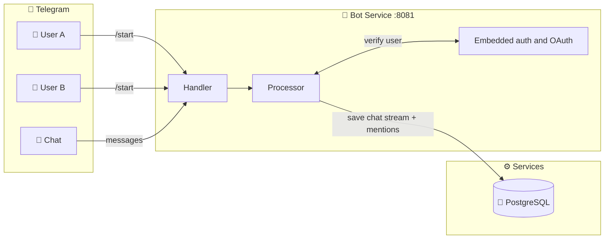
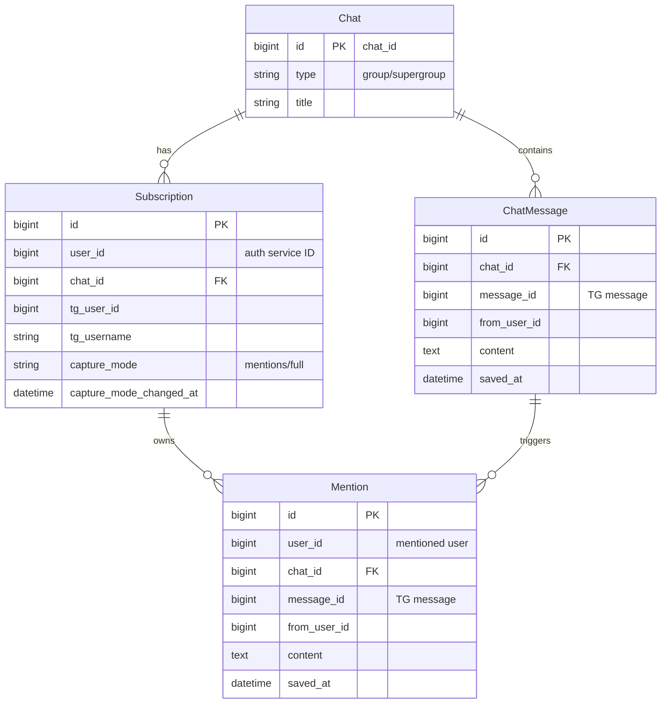
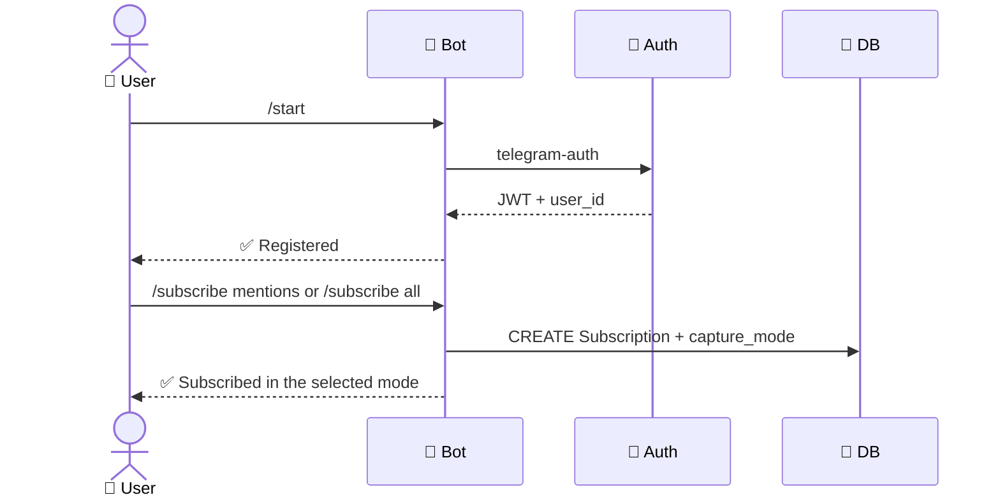
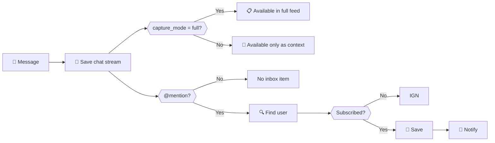
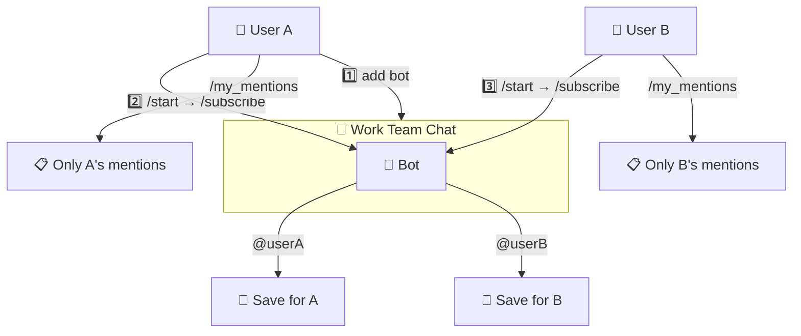

# Telegram Bot Architecture

## Problem and solution

```
Problem: A bot can only be added once to a chat; two users cannot each add the same bot.
Solution: Add one bot per chat and let multiple users subscribe to it.
```

## Overview



## Data model



## OAuth and MCP

Web and Telegram clients obtain a user session through the embedded authentication service on port 8081. For external AI clients, the bot acts as a protected MCP resource server: `POST /mcp` accepts an OAuth access token, and the embedded authorization server handles Authorization Code + PKCE and token introspection. An external authentication service remains available as an optional compatibility mode.

- MCP read tools require the `mentions:read` scope.
- Write tools require `mentions:write` and should be confirmed by the client before execution.
- Token validation and data ownership checks happen on the server; a `user_id` supplied by an MCP client is not accepted as authorization.

See [MCP_AND_CLI.md](../../MCP_AND_CLI.md) for the full protocol, discovery endpoints, CLI, and production configuration.

## Flows

### Registration and subscription



### Message processing



`ChatMessage` is the shared chat stream used for context. A subscription's mode determines the user's access: `mentions` provides the inbox and five messages before and after a mention, while `full` opens the complete feed only from `capture_mode_changed_at`. The API filters by `saved_at`, so previously saved history is not exposed after switching. Switching back to `mentions` immediately closes the full feed.

Text messages and media captions are stored in `text`; the service does not download binary attachments. Redelivery or editing of a Telegram message updates the existing `ChatMessage`. If an edit adds, changes, or removes a mention, its inbox item is synchronized without duplicates.

## Example: two users in one chat



## Bot commands

| Command | Where | Description |
|---------|-----|----------|
| `/start` | Private message | Register through the Auth API |
| `/subscribe [mentions\|all]` | Chat | Subscribe to mentions or the full feed |
| `/mode [mentions\|all]` | Chat | View or change the mode |
| `/unsubscribe` | Chat | Unsubscribe from the chat |
| `/my_mentions` | Private message | Mentions command (currently a placeholder) |
| `/help` | Anywhere | Show help |

## Benefits

| | |
|---|---|
| ✅ | One bot per chat, respecting Telegram's restriction |
| ✅ | Multiple users in one chat |
| ✅ | Data isolation: each user sees only their own data |
| ✅ | Scalable |
